<p align="center">
  
</p>

<p align="center">
  <strong>Encyclopédie interactive &amp; muséale de l'histoire de la mode féminine en France (XVIe – XXIe siècle)</strong><br />
  <em>Silhouettes vectorielles normalisées • Armatures et sous-structures mécaniques • Panthéon de la Haute Couture • PWA 100% Hors-Ligne</em>
</p>

<p align="center">
  
  
  
  
  
  
  
</p>

---

## 📸 Aperçu Général de l'Interface

<p align="center">
  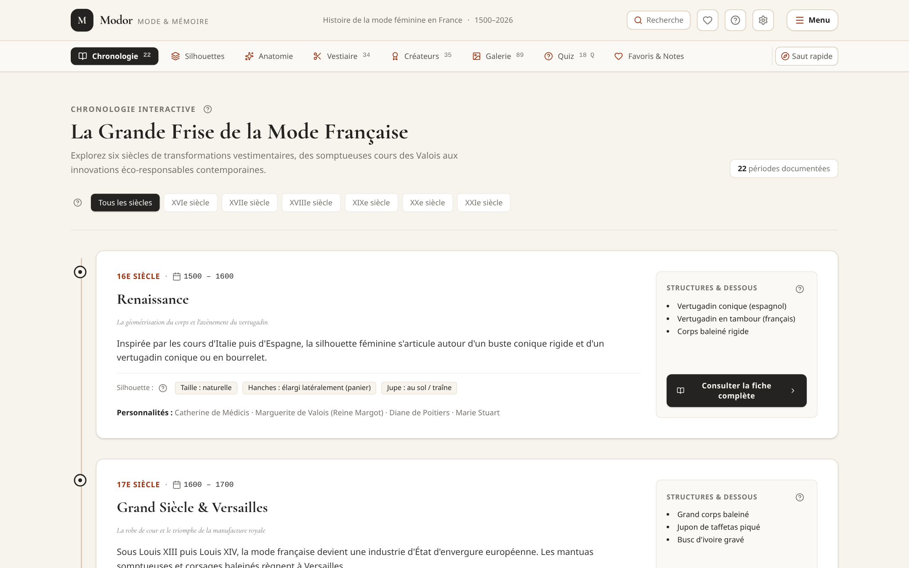
</p>
<p align="center"><em>Vue principale de l'application : Frise chronologique interactive (1500–2026), cartes richement documentées avec iconographie patrimoniale du domaine public et barre de navigation rapide permanente (QuickNavBar).</em></p>

---

## 🖼️ Galerie des Écrans Réels de l'Application

Les captures d'écran ci-dessous sont issues directement de l'application en cours d'exécution. Elles documentent l'état réel et actuel des 8 modules majeurs pour la documentation technique, le guide utilisateur et la préparation de la future page de destination (*landing page*).

| Module | Capture d'écran réelle | Description & Fonctionnalités clés |
| :--- | :--- | :--- |
| **1. Frise Chronologique** | [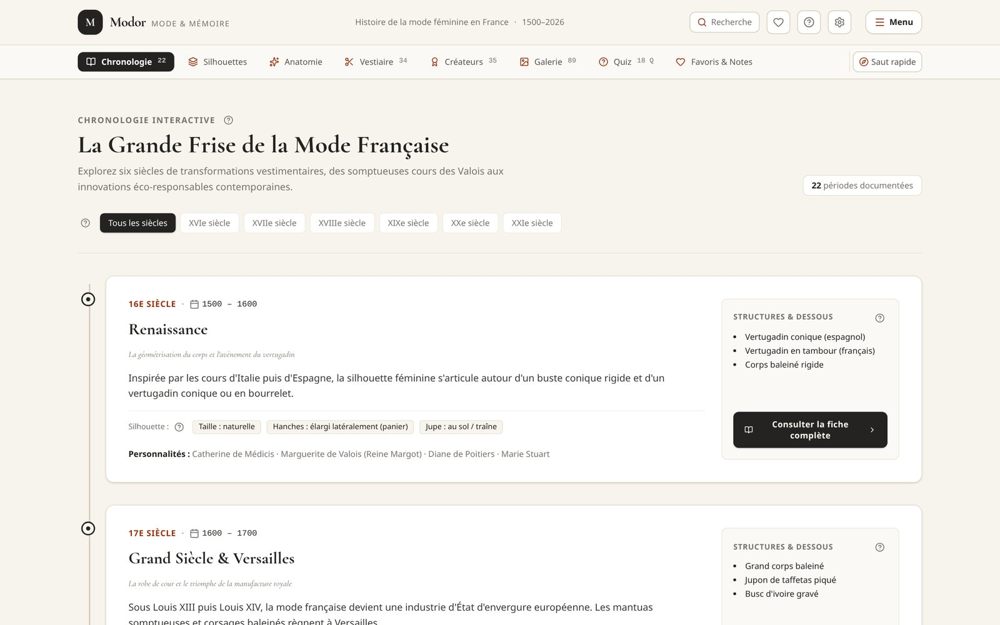](./docs/screenshots/01_chronologie_frise.png) | • 22 périodes historiques de 1500 à 2026<br />• Filtre par siècle (XVIe au XXIe siècle)<br />• Barre d'accès rapide sticky (QuickNavBar)<br />• Raccourcis clavier `Alt+1` à `Alt+8` |
| **2. Comparateur de Silhouettes** | [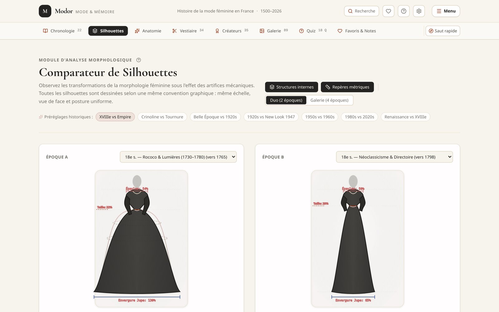](./docs/screenshots/02_silhouettes_comparateur.png) | • Mannequin vectoriel à échelle constante (8,5 têtes)<br />• Mode Duo et mode Galerie comparative<br />• Calques de sous-structures (vertugadin, panier, crinoline)<br />• Tableau morphologique différentiel automatisé |
| **3. Anatomie du Costume** | [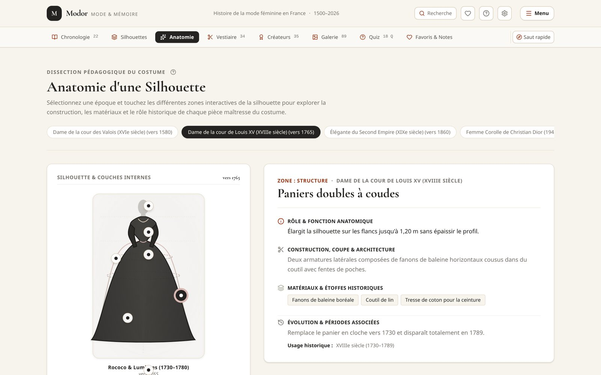](./docs/screenshots/03_anatomie_costume.png) | • Dissection interactive strate par strate<br />• Hotspots tactiles sur le corps féminin<br />• Analyse de la mécanique des dessous<br />• Fiches techniques : coupe, matières et fonction |
| **4. Catalogue du Vestiaire (34 pièces)** | [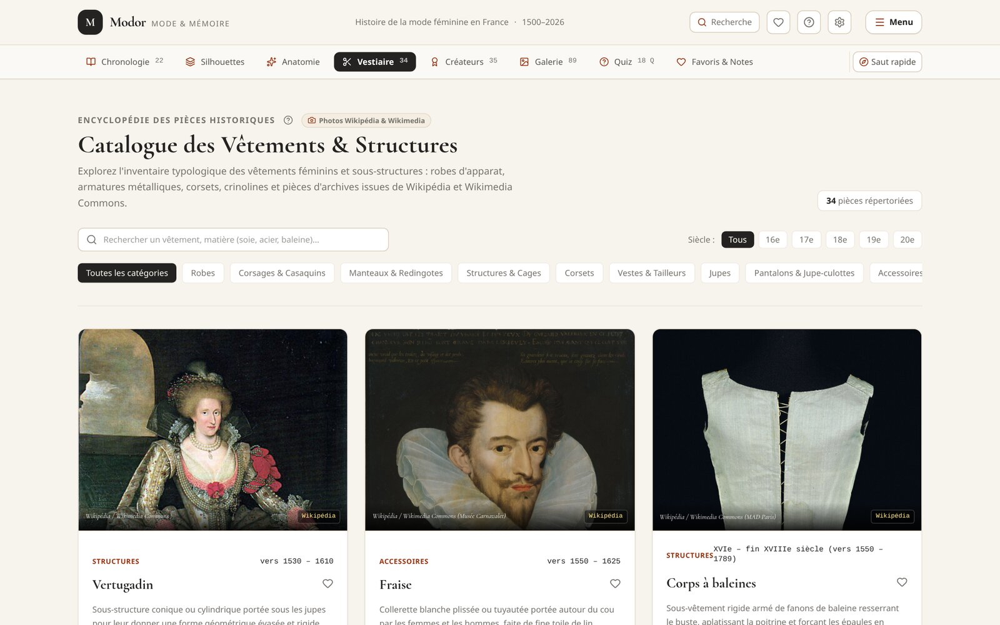](./docs/screenshots/04_catalogue_vestiaire.png) | • 34 pièces historiques de référence<br />• Filtres : *Robes*, *Corsages & Casaquins*, *Manteaux & Redingotes*, *Structures*, *Pantalons & Jupe-culottes*<br />• Clichés muséaux haute définition et modales de détails |
| **5. Panthéon des Créateurs (35 fiches)** | [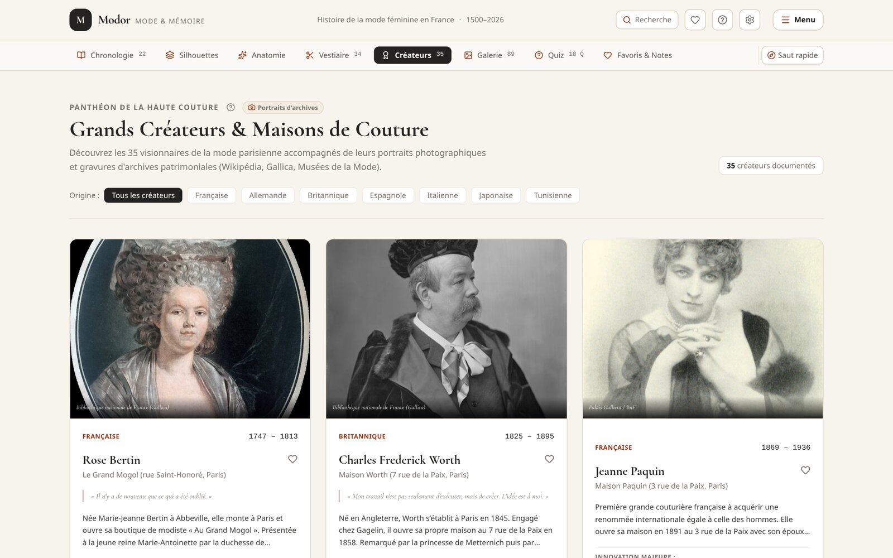](./docs/screenshots/05_pantheon_createurs.png) | • 35 créateurs et modistes de Rose Bertin à Jacquemus<br />• Filtres par nationalité (*France, Espagne, Italie, Japon, Tunisie, etc.*)<br />• Citations historiques authentifiées<br />• Innovations stylistiques majeures |
| **6. Grand Quiz de la Mode** | [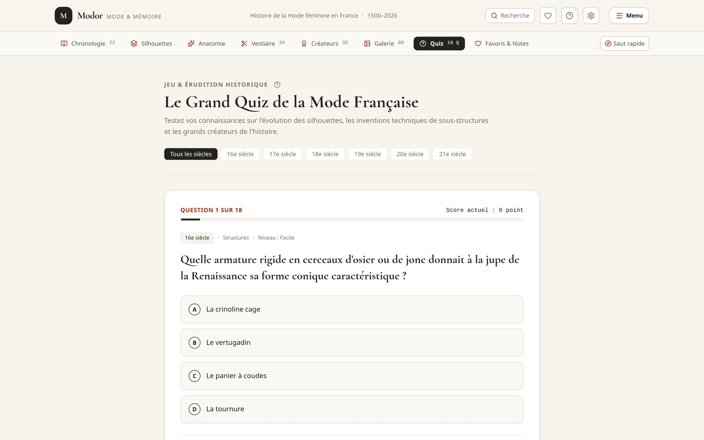](./docs/screenshots/06_grand_quiz.png) | • 18 questions d'érudition par niveau et par siècle<br />• Validation immédiate avec justification historique<br />• Encadré didactique *« Le saviez-vous ? »*<br />• Score mémorisé localement |
| **7. Menu Hamburger & Système PWA** | [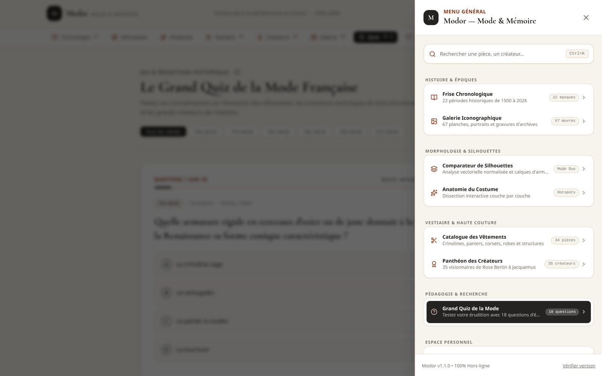](./docs/screenshots/07_menu_navigation.png) | • Menu latéral catégorisé en 6 univers<br />• Bouton d'installation PWA en 1 clic<br />• Mises à jour automatiques en arrière-plan<br />• Paramètres système et purge sécurisée des caches |
| **8. Accueil & Mentions Légales** | [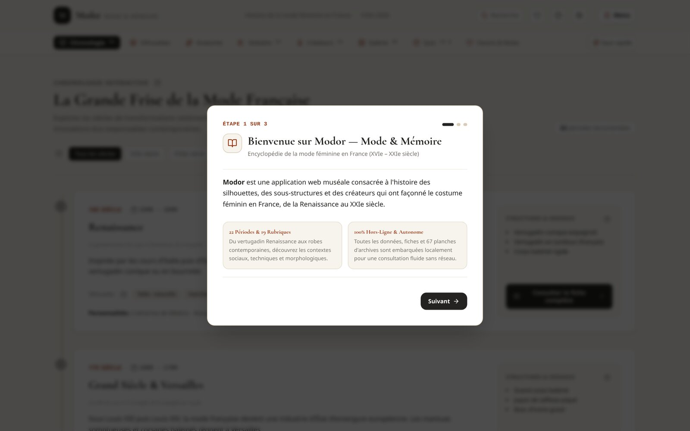](./docs/screenshots/08_onboarding_mentions.png) | • Parcours d'accueil didactique en 3 étapes<br />• **Clause exonératoire de responsabilité explicite**<br />• Engagement de stricte confidentialité (zéro pistage)<br />• Infobulles d'aide contextuelle pour novices |

---

## 🌟 Nouveautés Récentes (v1.5.0)

- ✂️ **Catalogue Raisonné Étendu à 34 Pièces Historiques** :
  - Conservation rigoureuse et inchangée des 22 pièces patrimoniales d'origine.
  - Ajout de 12 nouvelles notices historiques complètes : *Robe volante*, *Casaquin*, *Robe-chemise (Chemise à la reine)*, *Redingote féminine*, *Spencer féminin*, *Tea-gown*, *Pelisse féminine*, *Costume de cycliste féminin (1895)*, *Jupe-culotte (scandale d'Auteuil 1911)*, *Robe fourreau (1950)*, *Robe trapèze (1958)* et *Robe portefeuille (1974)*.
  - Nouveaux filtres de catégorie intégrés : *Corsages & Casaquins*, *Manteaux & Redingotes*, *Pantalons & Jupe-culottes*.
- 👑 **Panthéon Porté à 35 Grands Créateurs et Modistes** :
  - Ajout de 12 fiches biographiques illustrées : *Jeanne Lanvin*, *Madame Grès*, *Cristóbal Balenciaga*, *Gaby Aghion (Chloé)*, *Pierre Cardin*, *Paco Rabanne*, *Azzedine Alaïa*, *Christian Lacroix*, *Chantal Thomass*, *Adeline André*, *Issey Miyake* et *Jean-Charles de Castelbajac*.
  - Filtre dynamique par nationalité (France, Espagne, Italie, Japon, Tunisie, etc.).
- 🧭 **Barre de Menu Rapide Inter-Pages (QuickNavBar)** :
  - Barre de navigation sticky permanente sous l'en-tête permettant de basculer instantanément en un clic entre toutes les sections :
    - *Chronologie* (22 époques de 1500 à 2026)
    - *Silhouettes* (Comparateur vectoriel morphologique)
    - *Anatomie* (Dissection par strates et points tactiles)
    - *Vestiaire* (Catalogue des 34 pièces et structures)
    - *Créateurs* (Panthéon des 35 maisons et modistes)
    - *Galerie* (89 œuvres et photographies d'archives)
    - *Quiz* (Grand test d'érudition de 18 questions)
    - *Favoris & Notes* (Espace privé sauvegardé localement)
  - Défilement tactile fluide sur mobile, chevrons d'assistance, fil d'Ariane contextuel, menu déroulant « Saut rapide » et raccourcis clavier `Alt+1` à `Alt+8`.
- 🎨 **Visuels Historiques Authentiques du Domaine Public** :
  - 89 photographies d'archives et chefs-d'œuvre patrimoniaux issus des collections ouvertes (The Met, BnF Gallica, Palais Galliera, Muséum de Toulouse, LACMA, RISD Museum, MAD Paris).
  - Optimisation haute définition et mise en cache PWA hors-ligne.
- 🍔 **Menu Hamburger Catégorisé** :
  - Regroupement méthodique en 6 univers : *Histoire & Époques*, *Morphologie & Silhouettes*, *Vestiaire & Haute Couture*, *Pédagogie & Recherche*, *Espace Personnel*, et *Système & Application*.
- ⚙️ **Paramètres Système & Mises à Jour Automatiques en Arrière-Plan** :
  - Affichage de la version, date de sortie et horodatage de la dernière vérification.
  - Boutons « Vérifier les mises à jour » et « Forcer la mise à jour » avec purge sécurisée préservant les données privées.
  - Détection périodique automatique en arrière-plan sans interruption de l'utilisateur.
- 🛡️ **Onboarding & Mentions Légales Déclaratives** :
  - Parcours d'accueil guidé en 3 étapes.
  - **Clause exonératoire de responsabilité explicite** stipulant que l'auteur et éditeur décline formellement toute responsabilité quant aux données fournies.
- 💡 **Infobulles et Aide Contextuelle pour Utilisateurs Novices** :
  - Composant accessible `HelpTooltip` sur l'ensemble des écrans pour expliquer simplement la terminologie historique.
- 📲 **Bouton d'Installation PWA Intégré** :
  - Installation en 1 clic sur desktop (Chrome, Edge) et mobile (Android, iOS avec guide Safari personnalisé).

---

## 🏛️ Les Modules de l'Application en Détail

### 1. 📜 Chronologie Interactive (1500–2026)

<p align="center">
  
</p>

- **22 périodes historiques** de la Renaissance au XXIe siècle, structurées selon une grille uniforme de 19 rubriques patrimoniales.
- Filtrage direct par siècle (du XVIe au XXIe siècle).
- Fiches détaillées avec contexte géopolitique, évolution de la condition féminine, pièces d'apparat, coiffures, cosmétiques et souliers.

### 2. 📐 Comparateur de Silhouettes Normalisé

<p align="center">
  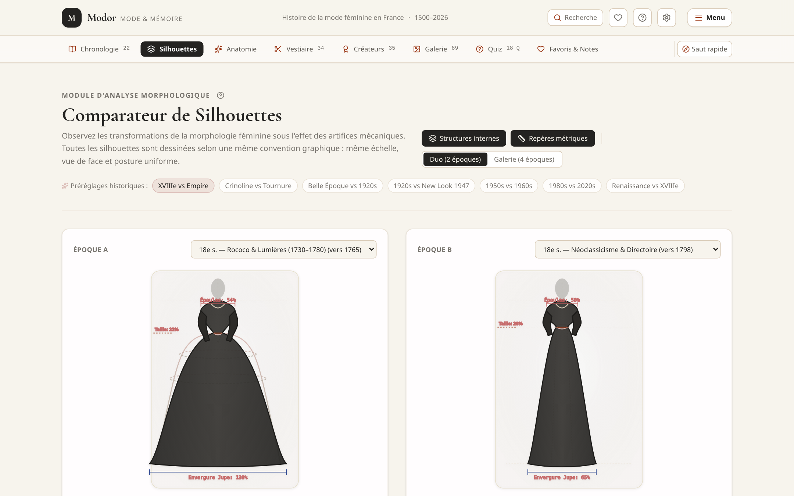
</p>

- Mannequin vectoriel unique respectant scrupuleusement la même échelle (canon anatomique de 8,5 têtes, vue de face, posture uniforme).
- Mode **Duo** (comparaison directe de 2 périodes) et **Galerie** (4 périodes simultanées).
- Calques d'armatures internes activables : vertugadin, paniers à coudes, crinoline cage, tournure, corolle New Look.
- Tableau morphologique différentiel calculant automatiquement les ratios de taille, d'épaules et d'envergure.

### 3. 🔬 Module « Anatomie d'une Silhouette »

<p align="center">
  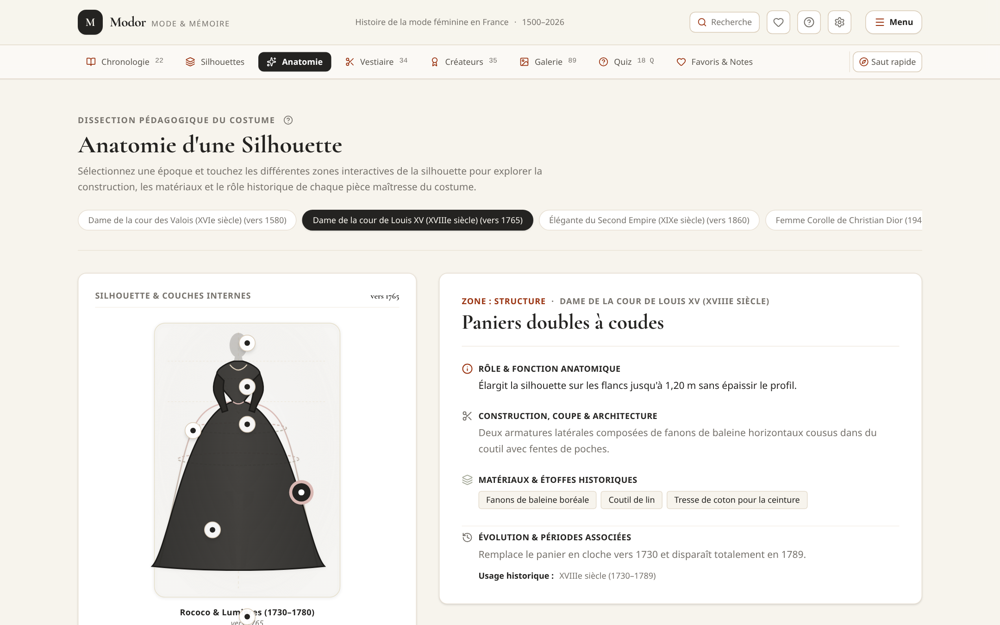
</p>

- Dissection visuelle par points d'intérêt interactifs (*hotspots*) répartis sur le corps.
- Analyse couche par couche des ruptures historiques majeures (Rococo 1750, Crinoline 1860, New Look 1947, Minimalisme 1990).
- Fiches techniques pour chaque couche : rôle anatomique, architecture de coupe, matières textiles et évolutions d'usage.

### 4. ✂️ Catalogue Raisonné des Vêtements & Structures

<p align="center">
  
</p>

- **34 pièces emblématiques répertoriées** :
  - *Robes* : Robe volante, Robe à la française, Robe à l'anglaise, Robe-chemise, Robe Empire, Robe Belle Époque, Robe garçonne, Robe charleston, Robe en biais, Robe fourreau, Robe trapèze, Robe portefeuille, Tea-gown.
  - *Corsages & Vestes* : Casaquin, Spencer, Tailleur féminin, Smoking féminin, Tailleur Power Dressing (années 1980).
  - *Manteaux* : Redingote féminine, Pelisse d'hiver.
  - *Structures & Dessous* : Vertugadin, Fraise, Corps à baleines, Paniers, Crinoline cage, Tournure, Corset sablier, Jupon d'apparat.
  - *Bifurcations & Émancipation* : Costume de cycliste (1895), Jupe-culotte (1911), Mini-jupe (1965), Pantalon flare (1970).
- Photographies muséales haute résolution issues des collections ouvertes (The Met, BnF Gallica, Palais Galliera, MAD Paris, LACMA).

### 5. 👑 Panthéon des Grands Créateurs

<p align="center">
  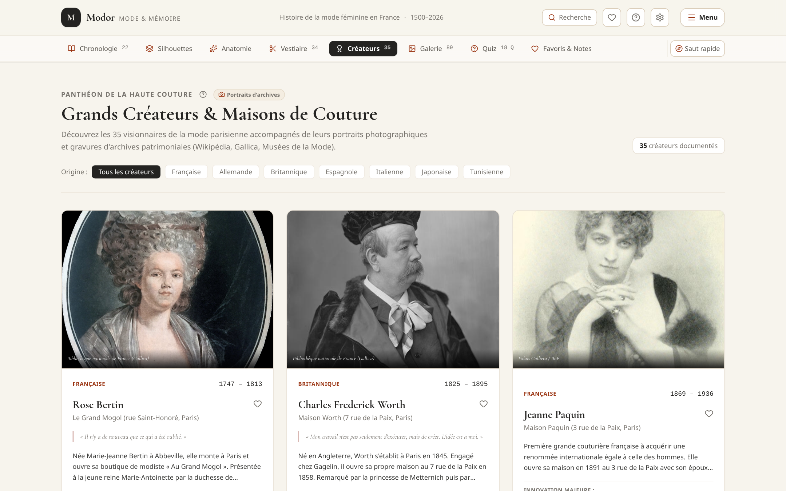
</p>

- **35 fiches biographiques complètes** de Rose Bertin (1770) à Simon Porte Jacquemus (2026).
- Présence des maîtres internationaux ayant façonné Paris : Cristóbal Balenciaga, Paco Rabanne, Azzedine Alaïa, Issey Miyake.
- Clichés photographiques et portraits patrimoniaux d'époque.
- Citations historiques vérifiées, innovations de coupe et créations emblématiques.

### 6. 🏆 Grand Quiz de la Mode Française

<p align="center">
  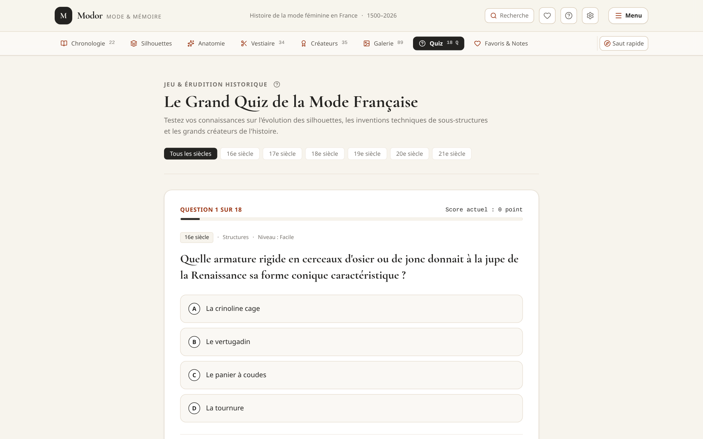
</p>

- 18 questions d'érudition réparties par siècle et niveau de difficulté (*Facile*, *Intermédiaire*, *Érudit*).
- Validation instantanée avec justification documentaire et encadré historique « Le saviez-vous ? ».
- Progression et meilleurs scores enregistrés localement.

### 7. 🍔 Navigation Catégorisée, PWA & Paramètres Système

<p align="center">
  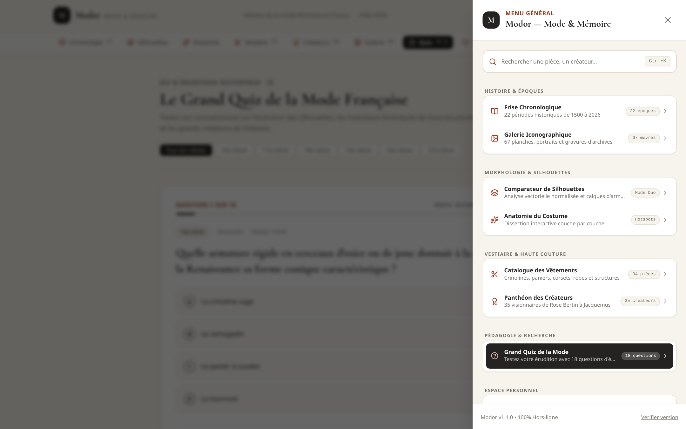
</p>

- Tiroir de navigation structuré en 6 rubriques thématiques.
- Bouton d'installation de la Progressive Web App sur l'écran d'accueil ou le bureau.
- Gestionnaire de mise à jour en arrière-plan avec purge sélective des caches et conservation des données utilisateur.

### 8. 🛡️ Parcours d'Onboarding & Mentions Légales

<p align="center">
  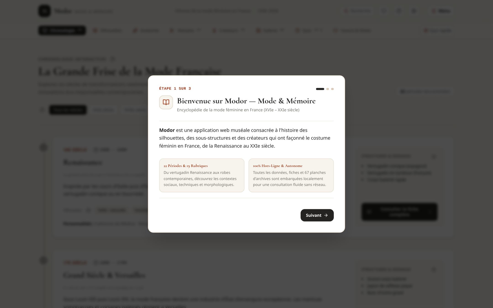
</p>

- Dialogue d'accueil en 3 étapes avec clause de non-responsabilité juridique explicite.
- Précision des engagements de confidentialité : données strictement confinées à l'appareil de l'utilisateur, zéro collecte externe.

---

## 🛠️ Stack Technique & Performance

| Domaine | Technologies |
| :--- | :--- |
| **Langage & Framework** | TypeScript (mode strict), React 18, Vite |
| **Design & Stylisme** | Tailwind CSS v4, Cormorant Garamond (titres), Plus Jakarta Sans (corps de texte) |
| **Composants & Icônes** | Lucide React |
| **Architecture PWA** | Web App Manifest, Service Worker avec stratégies de mise en cache intelligentes (CacheFirst + StaleWhileRevalidate) |
| **Qualité & Tests** | Vitest (68 tests automatisés : validation de schéma, intégrité d'images, interactions UI, navigation rapide), ESLint |
| **Déploiement** | 100% statique (Cloudflare Pages, Vercel, Netlify, Nginx) |

---

## 🚀 Installation & Commandes Développeur

```bash
# 1. Cloner le dépôt GitHub
git clone https://github.com/pnoualhier/Modor.git
cd Modor

# 2. Installer les dépendances
npm install

# 3. Démarrer le serveur de développement local (port 3000)
npm run dev

# 4. Exécuter l'ensemble des 68 tests automatisés
npm test -- --run

# 5. Valider la qualité du code (linter ESLint)
npm run lint

# 6. Compiler l'application pour la production
npm run build
```

---

## ⚖️ Mentions Légales & Avertissement

> **Clause de non-responsabilité :** L'auteur et éditeur de l'application Modor décline formellement toute responsabilité quant aux informations historiques, dates, attributions, descriptions techniques, reconstitutions et illustrations fournies. Ces contenus sont mis à disposition à titre purement culturel et informatif.
> 
> Toutes les illustrations et photographies d'archives proviennent des domaines publics ou de licences libres (Wikipédia, Wikimedia Commons, BnF Gallica, Palais Galliera, The Metropolitan Museum of Art, LACMA, RISD Museum). Aucune donnée personnelle n'est transmise ni collectée : vos favoris et vos notes demeurent exclusivement stockés sur votre terminal local.

---

## 📄 Dossiers Documentaires & Méthodologie

Retrouvez les dossiers méthodologiques détaillés dans le répertoire [`docs/`](./docs) :
- [`docs/screenshots/`](./docs/screenshots/) : Répertoire des 8 captures d'écran réelles en haute définition (formats PNG 2160x1350 et JPG optimisé).
- [`docs/AUDIT_INITIAL.md`](./docs/AUDIT_INITIAL.md) : Audit technique, sécuritaire et accessibilité initial.
- [`docs/ARCHITECTURE.md`](./docs/ARCHITECTURE.md) : Architecture modulaire, flux de données et stratégie offline.
- [`docs/SOURCES_ET_LICENCES.md`](./docs/SOURCES_ET_LICENCES.md) : Inventaire patrimonial des fonds et licences.
- [`docs/ACCESSIBILITE.md`](./docs/ACCESSIBILITE.md) : Conformité WCAG 2.2 AA.
- [`docs/TESTS.md`](./docs/TESTS.md) : Matrice de couverture des tests Vitest.
